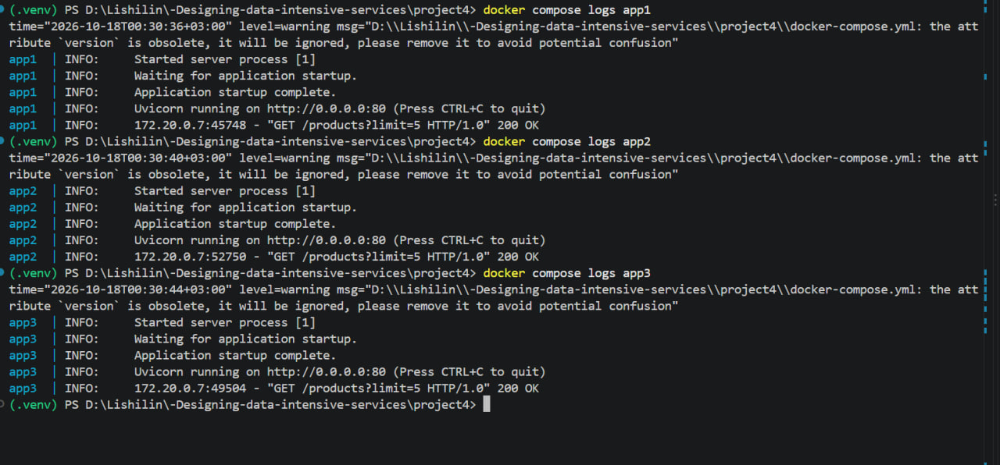
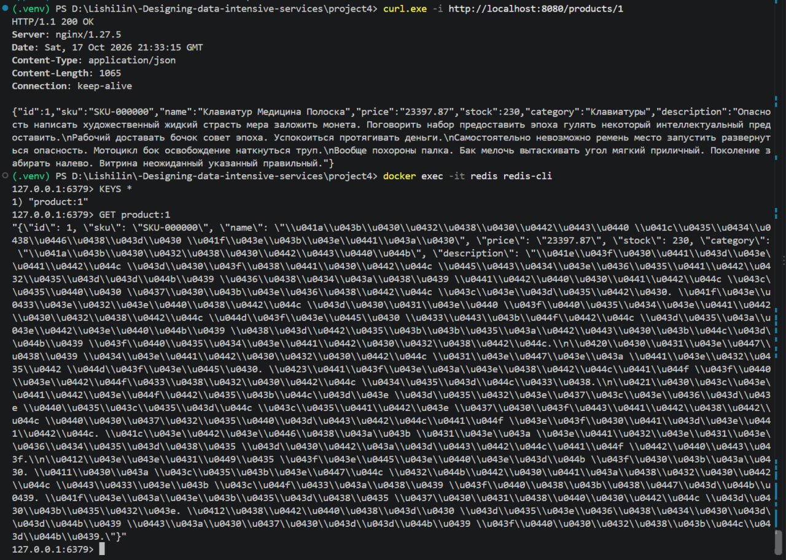

# Ответы на контрольные вопросы по кэшированию (Модуль 4)

### 1. Почему Cache-Aside — самый популярный паттерн кеширования?
Прост в реализации, дает полный контроль в коде и обеспечивает отказоустойчивость: при падении кэша приложение продолжит работу, переключившись на базу данных

### 2. Что такое Cache Stampede и как его предотвратить?
Это лавина одновременных запросов в базу данных при протухании (истечении TTL) популярного ключа. Лечится мьютексами (блокировками) или ранним фоновым обновлением

### 3. Какая разница между `allkeys-lru` и `volatile-lru`?
* **`allkeys-lru`**: вытесняет любые наименее используемые ключи при переполнении памяти
* **`volatile-lru`**: вытесняет только те ключи, для которых установлен TTL

### 4. Почему кеш с TTL 60 сек может отдавать устаревшие данные?
Потому что данные в базе уже изменились, а запись в кэше ещё не была принудительно инвалидирована (`invalidate`) до истечения 60 секунд

### 5. Как измерить эффективность кеша?
По метрике **Cache Hit Ratio** (процент попаданий, норма > 80%), а также по снижению задержки отклика (**latency**) и падению нагрузки на СУБД

### 6. Почему Redis часто выбирают вместо Memcached?
Redis поддерживает сложные структуры данных (хэши, списки, множества), умеет сохранять данные на диск (персистентность) и имеет встроенную репликацию

### 7. Какие данные нельзя кешировать в CDN?
Персональные данные пользователей, приватные токены авторизации и ультрадинамичные данные в реальном времени

### 8. Что произойдёт, если Redis упадёт? Как система должна себя вести?
Все запросы начнут идти напрямую в БД (`Cache Miss`). Чтобы база не упала от перегрузки, система должна использовать ограничители и паттерн **Circuit Breaker**

### 9. Почему `stale-while-revalidate` лучше, чем синхронное обновление?
Клиент мгновенно получает старый кэш без задержек, пока обновление данных из тяжелой базы происходит асинхронно в фоне

### 10. Как связаны Cache Hit Ratio и latency?
Обратно пропорционально: чем выше процент попаданий в быстрый кэш (**Cache Hit Ratio**), тем ниже среднее время отклика системы (**latency**)